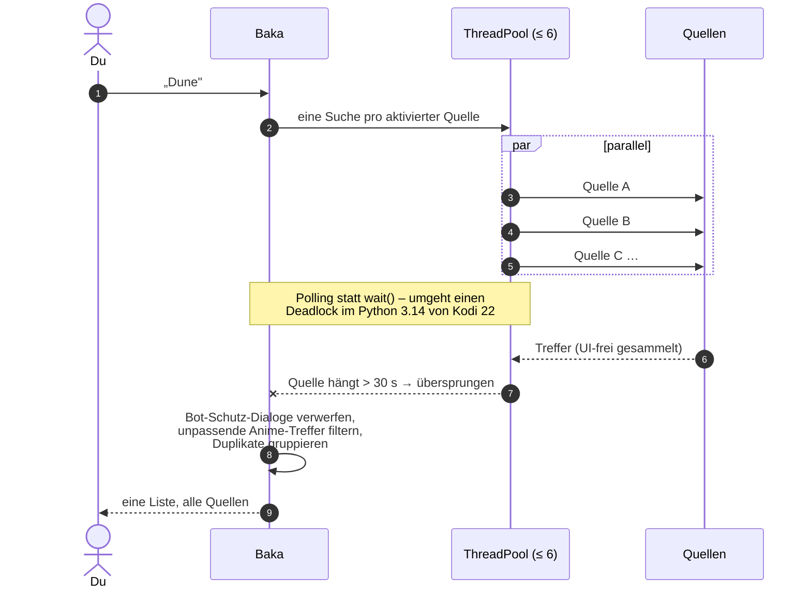

<!-- ═══════════════════════════════════════════════════════════════════════
     Baka · README
     Farben aus dem Markendesign: Violett #7B3FE4 → Smaragd #1FC38E
     ═══════════════════════════════════════════════════════════════════════ -->


<p align="center">
  
</p>

<p align="center">
  <a href="#-was-ist-baka">
    
  </a>
</p>

<p align="center">
  
  
  
  
</p>
<p align="center">
  
  
  
  
  
</p>

<p align="center">
  <a href="#-features">Features</a> ·
  <a href="#-livestreams--rabbithole">Livestreams</a> ·
  <a href="#-unter-der-haube">Architektur</a> ·
  <a href="#-sicherheit-nicht-verhandelbar">Sicherheit</a> ·
  <a href="#-installation">Installation</a> ·
  <a href="#-vision--roadmap">Vision</a> ·
  <a href="#-mitentwickeln">Mitentwickeln</a>
</p>

---

## 🎬 Was ist Baka?

> **Du willst einen Film sehen. Nicht zehn Apps öffnen.**

Baka ist ein **Meta-Suchmaschinen-Addon für Kodi**. Du tippst einen Titel ein –
Baka fragt **alle aktivierten Quellen gleichzeitig** ab, fasst doppelte
Treffer zusammen, hängt Cover, Bewertungen und Cast dran und legt dir alles in die
gewohnte Kodi-Oberfläche. Ein Klick, Hoster wählen (oder automatisch wählen lassen),
läuft.

> **Baka?** Steht für *Best AIO Kodi Addon* – und ja, auf Japanisch heißt es auch
> „Dummkopf“.

Drumherum ist ein ganzes Ökosystem gewachsen: TMDB-Kategorien über alle Quellen
hinweg, Zufallsfilme/-serien/-animes, verschachtelte Favoriten, Binge-Modus mit automatischer
nächster Folge, öffentlich-rechtliche Mediatheken, frei empfangbares Live-TV mit EPG –
und ein **Webcam-Rabbithole**, aus dem man nachts um drei nicht mehr rauskommt.

Baka ist der Nachfolger von xStream: komplett auf Python 3 umgebaut, mit eigenem
Branding, gehärtetem Kern und **Deutsch als erster Sprache**.

<p align="center">
  
  
  
  
  
  
</p>

---

## ✨ Features

<table>
<tr>
<td width="50%" valign="top">

### 🔎 Globale Suche
Eine Eingabe, alle Quellen – **parallel** in bis zu sechs Threads. Hängt eine
Quelle, wird sie nach einem einstellbaren Timeout (Standard 30 s) übersprungen,
statt die ganze Suche festzuhalten. Gleiche Titel aus verschiedenen Quellen werden
gruppiert („3 Quellen", „Alternative: …"). Suchbar auch gezielt nach Kategorie:
nur Filme, nur Serien, nur Animes …

</td>
<td width="50%" valign="top">

### 🗂️ Kategorien über *alle* Quellen
Aus TMDB statt aus einzelnen Webseiten: **Aktuelle Trends**, **Charts**,
**Genres**, **Jahrzehnte**, **Themen** (MCU, Star Wars, Superhelden …),
**Produktionsfirmen**, **Außerhalb Hollywood**, **berühmte Drehorte** und
**Personen**. Ein Klick auf einen Titel startet die Suche über alle Quellen –
mit Originaltitel, Jahr und Medientyp.

</td>
</tr>
<tr>
<td valign="top">

### 🎲 Zufällige Filme, Serien, Animes, Dokus
Ganz oben in jedem Inhaltsordner: **Random**, **nach Genre** und bei Filmen
**nach Filmproduktion** (Disney, Pixar …). Gezogen wird aus dem *gesamten*
datierten TMDB-Katalog seit 1800 – nicht nur aus den Top 10.000. Datumsbereiche
werden so lange geteilt, bis TMDB echte Trefferzahlen und alle Seiten liefert.
Animes, Dokus und Kinder mischen Filme und Serien. Optional mit IMDb-Mindestwertung.

</td>
<td valign="top">

### ⭐ Epic-Watchlist
Status-Listen (**Geplant**, **Am Schauen**, **Abgeschlossen**, **Abgebrochen**) und
daneben **eigene Watchlists** – jede mit Ordnern und Unterordnern, per Kontextmenü
anlegen, verschieben, umbenennen. **Liste abspielen** legt alle Filme und Folgen
einer Watchlist wie eine Episodenreihe in Kodis Wiedergabeliste. Gespeichert wird
nur der Plugin-Aufruf, nie eine Stream-URL – ein Eintrag überlebt jeden
Hoster-Wechsel.

</td>
</tr>
<tr>
<td valign="top">

### 📺 Binge-Modus
Staffeln starten optional als echte **Kodi-Wiedergabeliste**. „Nächster Titel"
springt nahtlos zur nächsten Folge – und auf Wunsch mit **demselben Hoster** wie
bei Folge 1. Kein Nachfragen, kein Dialog-Pingpong.

</td>
<td valign="top">

### 🎯 Bevorzugte Hoster
Pro Quelle oder global: Hoster **sortieren**, **filtern** oder **automatisch
starten**. Plus Kontextmenü „Mit Hoster-Auswahl abspielen", wenn man doch mal
selbst wählen will. Gespeichert werden nur Namen, nie Links.

</td>
</tr>
<tr>
<td valign="top">

### 🏛️ Mediatheken
**ARD** mit echten Serien-/Sendungsordnern, **ARTE** mit Kollektionen,
**MediathekViewWeb** mit allen Sendern (ZDF, 3sat, phoenix, KiKA, ORF, SRF, die
Dritten, funk …) samt Themenfiltern und senderbezogener Suche, dazu **Netzkino**
und **Rocket Beans TV** mit Konto-Login und „Meine Abos".

</td>
<td valign="top">

### 🎭 Personen mit Wikidata-Power
Beliebte **Schauspieler** und **Regisseure**, sortierbar nach A–Z, Filmanzahl,
**Oscars/Grammys** (Wikidata), IMDb-Bestwert oder IMDb-Durchschnitt. Filterbar nach
Produktionsgruppen: Hollywood, Deutsch, Japanisch, Koreanisch, Indisch …

</td>
</tr>
<tr>
<td valign="top">

### 🍅 Plot-Extras
Unter jeder Beschreibung optional **IMDb-**, **Rotten-Tomatoes-** und
**TMDB-Wertung**, Regie und die wichtigsten Darsteller – auch in Skins, die das
sonst nie anzeigen. (IMDb/RT über einen eigenen, kostenlosen OMDb-Key.)

</td>
<td valign="top">

### 🍪 Cookie-Assistent
Quelle hängt hinter Cloudflare oder DDoS-Guard? Im Browser die Prüfung
bestätigen, Anfrage „als cURL kopieren", einfügen – **direkt in Kodi oder vom
Handy/PC** über eine kleine Seite, die Baka kurz im Heimnetz anbietet.
Vollautomatisch geht's mit **FlareSolverr**.

</td>
</tr>
<tr>
<td valign="top">

### 🌐 Domain-Umschalter
DNS-Sperre beim Provider? Bekannte Ausweich-Domains einer Quelle sind direkt aus
dem Menü wählbar. Aufgenommen wird nur, was per **Fingerabdruck** (gleiche
Stylesheets, gleicher Theme-Ordner) nachweislich *dieselbe* Installation ist.

</td>
<td valign="top">

### 🕘 Historie & 💾 Backup
Lokale **Wiedergabe-Historie** (bis 1000 Einträge oder unbegrenzt, abschaltbar).
**Export/Import** für alles oder einzeln: Einstellungen, Konten, Epic-Favorites.
Und wer von xStream kommt: Daten werden beim ersten Start **automatisch
übernommen**.

</td>
</tr>
</table>

### 🧭 So sieht das Hauptmenü aus

```text
Baka
├── ⭐ Epic-Watchlist           ← immer oben: Status-Listen, eigene Watchlists, Historie
├── 🔎 Globale Suche            ← alle · Filme · Serien · Animes · Dokus · Kinder
├── 📂 Alle / Filme / Serien / Animes / Dokus / Kinder   ← Quellen in deinen Sprachen, oben 🎲 Zufällig,
│                                                          unten 🌐 Weitere Sprachen
├── 📡 Livestreams              ← TV · Sport · Social · Wetter · Webcams · Rabbithole
├── 🗂️ Kategorien               ← Trends · Mediatheken · Charts · Genres · Themen · Personen …
├── 🕘 Historie
└── ⚙️ Einstellungen
```

Die Reihenfolge ist frei verschiebbar (nur Epic-Favorites bleibt bewusst ganz oben).
Jede Quelle trägt ihre Kategorien selbst – eine Seite kann gleichzeitig unter Filme,
Serien *und* Dokus auftauchen.

### 📊 Quellenlandschaft

| Kategorie | Site-Plugins | Highlights mit freiem/öffentlichem Angebot |
|:--|:--:|:--|
| 🎬 Filme  | 27 | ARD Mediathek, ARTE, MediathekViewWeb, Netzkino, Internet Archive |
| 📺 Serien | 28 | ARD-Serienordner, ARTE-Kollektionen, Rocket Beans TV |
| 🍥 Animes | 15 | – |
| 🎓 Dokus  | 32 | media.ccc.de, YouTube-Doku-Kanäle, Doku-Portale, Mediatheken |
| 🧸 Kinder |  3 | Kids Tube, ARD Mediathek, MediathekViewWeb |
| 📡 Live   |  2 | Öffentlich-rechtliches Live-TV, Webcam-Katalog |

Mehrfachzuordnungen sind gewollt. Ein neues Plugin ohne Kategorie landet nicht im
Nirgendwo, sondern sicher unter **Weitere Quellen**.

---

## 📡 Livestreams & Rabbithole

<table>
<tr>
<td width="33%" valign="top">

#### 📺 Fernsehen
Rund **220 frei empfangbare Sender** aus DE/AT/CH – ARD mit allen Dritten und
WDR-Lokalzeiten, ZDF-Familie, 3sat, arte, ORF III, ServusTV, Regionalsender,
Offene Kanäle, Bundestag … nur von **offiziellen Sender-Servern**. Dazu rund
**190 Pluto-TV-Sender** über die offizielle Schnittstelle.

</td>
<td width="33%" valign="top">

#### ⚽ Sport & 🎮 Social
Red Bull TV, Darts, Snooker, Tennis Channel, Top Gear, FIFA+ und mehr.
**YouTube** und **Twitch** laufen über deren offizielle Kodi-Addons – Login und
API-Keys bleiben dort, wo sie hingehören.

</td>
<td width="33%" valign="top">

#### 🌦️ Wetter & 📷 Webcams
Wetter über **Open-Meteo** (ohne Key) oder optional OpenWeatherMap.
Öffentliche Webcams nach Ländern → Städten und Themen: Berge, Tiere, Vögel,
Strände, Piers, Parks, Verkehr. Jede mit Betreiberquelle und Prüfdatum.

</td>
</tr>
</table>

<p align="center"><b>🐇 Und dann ist da noch das Rabbithole.</b></p>

> Eine zufällige Webcam. Dann noch eine. Und noch eine.
> Ein Hafen in Seebruck, ein Strand in Kellenhusen, ein Platz in Hildesheim, irgendwo
> ein Adlerhorst. **Keine Wiederholung** innerhalb der Sitzung – die Engine merkt sich,
> was du schon gesehen hast, und vergisst es beim Kodi-Neustart wieder (RAM-only,
> kein Dateimüll). Ändern sich Filter oder Kategorien, startet die Session neu.
> Mit dem optionalen Keymap [`baka-rabbithole.xml`](resources/keymaps/baka-rabbithole.xml)
> springt die **Pfeiltaste ↓** im Vollbild direkt zur nächsten Kamera.

**Für Power-User:** Der Hintergrunddienst schreibt `playlist.m3u` und `guide.xml`
(XMLTV) nach `special://profile/addon_data/plugin.video.baka/livestreams/` –
damit wird der **PVR IPTV Simple Client** zum vollwertigen TV-Guide. Im Addon selbst
gibt's „Jetzt / Danach" direkt am Sender. Der Button **„IPTV-Simple-Einrichtung
anzeigen"** zeigt den Pfad, **„Quellen prüfen"** validiert den Katalog.

> [!IMPORTANT]
> **Rechterahmen:** Im Livestream-Bereich erscheint nur, was eine belegte Rechtelage
> hat (offizielle Quelle oder `rights_evidence_url`). DRM, Login und Geo-Sperren werden
> ehrlich markiert und **nicht umgangen**. Kein Aufspüren ungesicherter fremder
> Kameras, keine Grauzonen-Aggregation.

---

## 🧠 Unter der Haube

```mermaid
flowchart LR
    K([Kodi<br/>plugin://]) --> D[default.py]
    D --> P{baka.py<br/>parseUrl}
    P -- Whitelist-Check --> S[[sites/*.py<br/>49 Site-Plugins]]
    P --> C[categories.py<br/>TMDB · OMDb · Wikidata]
    P --> L[livestreams/<br/>route · catalog · epg]
    P --> F[Epic-Favorites<br/>Historie · Backup]
    S --> R[cRequestHandler<br/>TLS · Timeouts · Cache]
    R --> W[(Webseiten)]
    S --> H[gui/hoster.py]
    H --> U[ResolveURL]
    U --> PL([▶ Kodi-Player])
    L --> PL
    SV[service.py] -. M3U/XMLTV .-> IPTV([PVR IPTV Simple])
    SV -. Cache · Checks .-> P
    G[contentgate.py<br/>fail-closed] -. Sichtbarkeit / NSFW .-> L
    G -. .-> P

    style P fill:#7B3FE4,color:#fff,stroke:#7B3FE4
    style G fill:#1FC38E,color:#000,stroke:#1FC38E
    style U fill:#1FC38E,color:#000,stroke:#1FC38E
```

<details>
<summary><b>🔍 Wie die globale Suche wirklich läuft</b></summary>



</details>

<details>
<summary><b>🗺️ Wo was liegt</b></summary>

| Bereich | Pfad |
|:--|:--|
| Einstieg, Routing-Whitelist, Hauptmenü, globale Suche | [`baka.py`](baka.py) |
| Hintergrunddienst (Cache, Versions-Checks, Export) | [`service.py`](service.py) |
| Site-Plugins (eine Datei pro Quelle) | [`sites/`](sites/) |
| GUI-Abstraktion, Hoster-Auswahl, Player | [`resources/lib/gui/`](resources/lib/gui/) |
| HTTP, Bot-Schutz, Download-Handler (JDownloader, pyLoad) | [`resources/lib/handler/`](resources/lib/handler/) |
| TMDB-Kategorien, Personen, Zufallsfilme | [`categories.py`](resources/lib/categories.py) · [`persondata.py`](resources/lib/persondata.py) · [`randommovies.py`](resources/lib/randommovies.py) |
| Livestreams: Katalog, Provider, EPG, M3U, Rabbithole | [`resources/lib/livestreams/`](resources/lib/livestreams/) |
| Zentrale Sichtbarkeits-/NSFW-Logik | [`contentgate.py`](resources/lib/contentgate.py) |
| Favoriten, Historie, Episoden-Queue, Hoster-Präferenzen | [`epicfavorites.py`](resources/lib/epicfavorites.py) · [`history.py`](resources/lib/history.py) · [`episodequeue.py`](resources/lib/episodequeue.py) · [`hosterprefs.py`](resources/lib/hosterprefs.py) |
| Build, Repo, Katalog-Tools | [`tools/`](tools/) |
| Architektur & Regeln für Mitentwickler:innen | [`docs/CODING-PLAN.md`](docs/CODING-PLAN.md) |

</details>

---

## 🔒 Sicherheit (nicht verhandelbar)

Baka verarbeitet ständig fremdes HTML, fremde JSON-Antworten und
`plugin://`-URLs, die jeder basteln kann. Deshalb gelten feste Regeln:

|  | Regel |
|:--:|:--|
| 🚫 | **Kein `eval()` / `exec()`** auf Fremddaten. Cache läuft über JSON, nie über `repr()`. |
| 🔐 | **TLS-Prüfung ist an.** Ausnahmen nur pro Quelle, opt-in und mit Log-Warnung. |
| 🧱 | **Routing nur über eine Whitelist** – eine manipulierte URL kann keine beliebige Funktion aufrufen. |
| 🗝️ | **Keine hartcodierten Keys.** Eigene API-Keys kommen aus den Einstellungen (oder aus dem YouTube-Addon). |
| 📦 | **Zip-Slip-Schutz** bei allem, was entpackt wird. |
| 🙈 | **Zugangsdaten und Token werden im Log geschwärzt.** |
| 🔞 | **NSFW ist fail-closed:** ein einziger expliziter Schalter. Fehlt einem Inhalt die Markierung, bleibt er unsichtbar. |
| 📺 | **Fehler gehören ins Log, nicht auf den Fernseher** – statt eines abgeschnittenen Python-Traces kommt eine verständliche Meldung. |

---

## 🚀 Installation

> [!TIP]
> Ausführliche Anleitung mit allen Voraussetzungen: **[INSTALL.md](INSTALL.md)**

1. In Kodi unter **Einstellungen → Dateimanager → Quelle hinzufügen** diese Adresse eintragen:
   ```text
   https://flowinthefluid.github.io/baka/repo/
   ```
2. **Add-ons → Aus ZIP-Datei installieren** → `repository.baka-1.0.7.zip`
3. **Aus Repository installieren → Baka Repository → Video-Addons → Baka**
4. Fertig. ResolveURL 5.1.209 kommt als Abhängigkeit aus demselben Repository mit,
   Updates laufen über Kodis Add-on-Verwaltung.

**Voraussetzungen:** Kodi 22 „Piers" (Kodi 21 „Omega" läuft als Fallback mit) ·
`script.module.resolveurl` ≥ 5.1.209 · optional `inputstream.adaptive` (HLS/DASH)
und `inputstream.rtsp` (RTSP-Webcams) – fehlt eines, fällt nur diese Wiedergabeart weg.

> [!NOTE]
> **Umsteiger von xStream:** Einstellungen, Favoriten und Daten werden beim ersten Start
> automatisch übernommen, sofern xStream noch installiert ist. Vorhandene Dateien werden
> nie überschrieben.

---

## 🎛️ Feintuning

<details>
<summary><b>🌐 Sprachen & Regionen</b></summary>

- Beim ersten Start fragt Baka einmal, welche Sprachen du verstehst.
- **Einstellungen → Sprachen & Regionen**: Tonsprachen (je ein Schalter, dazu die
  bevorzugte), *Original mit Untertiteln* (z. B. Japanisch mit deutschen
  Untertiteln), **Meine Länder** und die Sprache für Titel und Beschreibungen.
- Quellen in deinen Sprachen stehen direkt im Inhaltsordner, alle anderen unter
  **🌐 Weitere Sprachen** – oder werden ganz ausgeblendet. Die globale Suche fragt
  nur Quellen in deinen Sprachen ab; ihre Einstellungen erscheinen auch nur dann.
- Streams werden nach deinen Sprachen gefiltert und sortiert: bevorzugte Tonsprache
  zuerst, dann weitere Tonsprachen, dann Original mit Untertiteln.
- **Meine Länder** steuert Mediatheken (bei mehreren Ländern mit Länderebene) und
  Live-TV. Webcams und Wetter bleiben weltweit. Nichts gewählt bedeutet alle Länder.
- **Kategorien → Weltkino**: Bollywood, K-Drama, Türkische Serien, Nollywood,
  Telenovelas und mehr; einzelne Einträge lassen sich in den Kategorien-Einstellungen
  ausblenden.

</details>

<details>
<summary><b>🎲 Zufallsauswahl & Kategorien-Filter</b></summary>

- **Zufällige Filme / Serien / Animes / Dokus / Kindertitel** stehen ganz oben im
  jeweiligen Inhaltsordner und öffnen **Random**, **Nach Genre** und bei Filmen
  zusätzlich **Nach Filmproduktion**.
- Unter **Einstellungen → Zufall** hat jede Art eigene erlaubte Genres, Anzahl
  (Standard 250) und IMDb-Mindestwertung. Bei mehreren Genres fliegt ein Titel raus,
  sobald er einem abgewählten Genre angehört. Die gezielte Genre-/Firmenauswahl
  ignoriert diese Ausschlüsse. Serien schließen News und Talkshows standardmäßig aus.
- Animes sind japanische Animationstitel, Dokus das Genre Dokumentation, Kinder sind
  Familienfilme und Kinderserien. Diese drei mischen Filme und Serien anteilig.
- Gezogen wird aus allen datierten, erschienenen TMDB-Titeln ohne Erwachsenenmarkierung
  seit 1800. Titel ohne Datum fehlen; ob ein Titel irgendwo streambar ist,
  wird erst beim Klick über die aktivierten Quellen gesucht. Der erste Aufruf zählt
  den Katalog durch und dauert länger; danach hilft der Webseiten-Cache (bis 6 Stunden).
- Unter **Einstellungen → Kategorien** gibt es getrennte Mindestwerte für IMDb, TMDB
  und TMDB-Stimmen. **IMDb** nutzt echte OMDb-Wertungen (eigener Key unter **TMDB**);
  fehlende Wertungen werden bei aktivem IMDb-Filter ausgeschlossen. Random prüft
  maximal 1000 Kandidaten – starke Filter können weniger Treffer liefern.
- **Aktuelle Trends** kombiniert die wöchentlichen TMDB-Trends, **Charts** trennt Filme
  und Serien, **Themen** beruhen auf exakten TMDB-Schlagwörtern (ohne
  Popularitäts-Ersatzliste).
- Bewertungsfilter gelten nur für den TMDB-Katalog, nicht für Mediatheken oder Personen.

</details>

<details>
<summary><b>🎭 Schauspieler & Regisseure</b></summary>

- Eigene Einstellungsbereiche für **Schauspieler** und **Regisseure**: Sortierung,
  Produktionsgruppen (Mehrfachauswahl) und Anzahl getrennt einstellbar.
- Sortierung nach **A–Z**, Filmanzahl, Oscars/Grammys, **IMDb: bester Film** oder
  **IMDb: Durchschnitt** (ungewichtet, OMDb-Key nötig; kostenloser Tarif: 1.000 Abfragen/Tag).
- Filmwertungen werden 14 Tage quellenübergreifend gecacht, um das API-Limit zu schonen.
- Produktionsgruppen richten sich nach Produktionsländern der Filme (Wikidata), nicht
  nach Nationalität. Koproduktionen erlauben mehrere Gruppen.
- Der Pool umfasst bis zu 500 beliebte Personen je Rolle plus eigene Schauspieler –
  **keine** vollständige Weltrangliste. **0** zeigt alle passenden Personen im Pool.

</details>

<details>
<summary><b>🏛️ Mediatheken & Rocket Beans TV</b></summary>

- **Mediatheken** sind standardmäßig sichtbar, unabhängig von den
  Suchquellen-Schaltern (abschaltbar unter **Einstellungen → Kategorien**).
- **ARD** öffnet redaktionelle Bereiche und Serien-/Sendungsordner, **ARTE** zeigt
  Kollektionen und Themenbereiche. Bei **MediathekViewWeb** führen Sender zu neuen
  Videos, Themenfiltern und senderbezogener Suche (Themenfilter sind Suchbegriffe,
  keine redaktionellen Genres).
- **Rocket Beans TV**: neue Folgen, Sendungen A–Z mit Staffeln und Seitennavigation.
  Freie Videos starten über das offizielle **YouTube**-Addon (wird bei Bedarf zur
  Installation angeboten).
- **Konto:** unter **Einstellungen → Konten → Rocket Beans TV** anmelden, optional mit
  Zwei-Faktor-Code. Danach erscheint **Meine Abos**. Das Passwort wird nach der Anmeldung
  entfernt, der Sitzungstoken bleibt lokal (Kodi verschlüsselt Einstellungen nicht).

> [!WARNING]
> Die echte Rocket-Beans-Anmeldung ist noch nicht mit einem Testkonto bestätigt; ein
> Browser-Captcha kann sie verhindern. Supporter-Videos ohne freien YouTube-Stream sind
> noch nicht abspielbar.

</details>

<details>
<summary><b>📡 Livestream-Einstellungen</b></summary>

- **Menü anpassen:** sichtbare Bereiche, Länder-Whitelist/Blacklist, Genres,
  Rabbithole-Kategorien.
- **Erwachsene Inhalte (NSFW):** ein einziger expliziter Schalter (`showAdult`), nie
  implizit über eine Genre- oder Länderwahl.
- **EPG:** XMLTV-Quellen (auch gzip/xz) und Vorschaufenster.
- **Wetter:** Städte, Einheiten, optionaler OpenWeatherMap-Key.
- **Social Media:** YouTube/Twitch ein/aus, optionale eigene API-Keys, Direktsprung in
  die Addon-Einstellungen.
- **Daten & Export:** Aktualisierung, IPTV-Simple-Einrichtung, Quellen prüfen.
- **Pluto TV** ist separat abschaltbar.

</details>

---

## 🔮 Vision & Roadmap

> **Ein Ort für alles, was man in Kodi gucken will** – schnell, deutsch, ehrlich.
> Nicht die meisten Quellen um jeden Preis, sondern die, die funktionieren.
> Und wenn etwas nicht geht, sagt Baka das, statt so zu tun als ob.

**Auf dem Radar**

- [ ] 🌐 **FlareSolverr-HTML-Modus** – gerendertes HTML statt nur Cookies; macht auf einen Schlag mehrere JavaScript-Seiten erreichbar
- [ ] ⏱️ **Timeout pro Quelle** statt global – Voraussetzung für Live-Ketten mit langen Ladezeiten
- [ ] 🔖 **Watchlists der Quellen** als eigene Kategorie, sobald Zugangsdaten hinterlegt sind
- [ ] 🎚️ **Erweiterte Suche mit Quellenfilter** – Quellen gezielt ein- oder ausschließen
- [ ] 🔊 **Hörbücher & Podcasts** (Deutschlandfunk & Co.) als eigener Medientyp
- [ ] 🐂 **Red Bull TV als Mediathek** – sobald Katalog *und* Wiedergabe bestätigt sind
- [ ] 💎 **Rocket-Beans-Supporter-Videos**
- [x] ~~Favoriten mit Ordnern~~ → Epic-Favorites
- [x] ~~NSFW-Schalter~~ → fail-closed Content-Gate
- [x] ~~Live-TV über M3U/XMLTV~~ → Export für IPTV Simple
- [x] ~~Zufallsauswahl~~ → drei Modi über den ganzen TMDB-Katalog

**Was Baka bewusst *nicht* baut** – und warum

| ❌ | Grund |
|:--|:--|
| Torrent-Anbindung | Macht die eigene IP für jeden im Schwarm sichtbar – genau daran hängen die Abmahnungen. Ein Rückschritt für die Nutzer. |
| Öffentliche Proxys / Gratis-VPNs | Bekannte Quelle manipulierter Ausgangsknoten. Gegen DNS-Sperren reichen DNS-over-HTTPS und der Domain-Umschalter. |
| Automatisch geteilte Fremd-Logins | Das Feld für *eigene* Zugangsdaten gibt's – fremde Konten automatisiert einzusetzen nicht. |
| DRM-, Geo- oder Login-Umgehung | Wird ehrlich markiert, nicht ausgehebelt. |
| Fragwürdige Erwachsenen-Portale | Inhaltliche Entscheidung, unabhängig von Sprache oder Technik. |

---

## 🧩 Mitentwickeln

Baka läuft ausschließlich unter **Python 3**. Jede Quelle ist ein eigenständiges
Modul unter [`sites/`](sites/) – austauschbar, einzeln abschaltbar, einzeln testbar.

```python
# sites/meinequelle.py – das Grundgerüst
SITE_IDENTIFIER    = 'meinequelle'
SITE_NAME          = 'Meine Quelle'
SITE_ICON          = 'meinequelle.png'
CONTENT_CATEGORIES = ('filme', 'serien')   # wo die Quelle im Menü auftaucht
SITE_LANGUAGES     = ('de', 'en')           # Tonsprachen; () = sprachunabhängig
SITE_SUBTITLES     = ('de',)                # optional: Untertitel bei Originalton

def load():
    ...   # Menü der Quelle

def showEntries(entryUrl=False, sGui=False, sSearchText=False):
    ...   # Liste – GUI nur über cGui/cGuiElement, HTTP nur über cRequestHandler
```

**Die drei goldenen Regeln für neue Quellen**

1. Jede von außen aufrufbare Funktion **muss** in `SCRAPER_ENTRY_FUNCTIONS` in
   [`baka.py`](baka.py) stehen – sonst ist sie nicht routbar.
2. **Kein** `xbmcplugin`/`xbmcgui`/`requests`/`xbmcaddon` direkt im Site-Plugin.
3. Registrieren mit einem Befehl statt 40 Zeilen an drei Stellen:
   ```sh
   python tools/register_site.py meinequelle 30799 "Meine Quelle"
   ```
   Die Einstellungen der Quelle erscheinen nur, wenn eine ihrer Sprachen gewählt
   ist. Nach Änderungen an `SITE_LANGUAGES`/`SITE_SUBTITLES`:
   `python tools/register_site.py --sync-languages`.
4. Streams mit `languages.tagStream(hoster, audio, subs)` kennzeichnen statt eigener
   Sprachweichen – Filter, Anzeige und Sortierung kommen dann aus
   [`languages.py`](resources/lib/languages.py).

**Vor jedem Commit**

```sh
python -m pytest tests/ -q                                            # Kodi-Stubs inklusive
python -W error::SyntaxWarning -m compileall -q -f -x "\.tmp|design|__pycache__" .
python -m pyflakes .
```

Die CI (GitLab und GitHub Actions) führt die Tests aus und baut daraus automatisch das
Kodi-Repository mit allen ZIPs. Architektur, Konventionen und Sicherheitsregeln im
Detail: **[docs/CODING-PLAN.md](docs/CODING-PLAN.md)**.

Quellcode, Tickets und Releases: **[gitlab.com/gerxstream/gerxstream](https://gitlab.com/gerxstream/gerxstream)**
· Mirror: [github.com/flowinthefluid/baka](https://github.com/flowinthefluid/baka)

---

## ⚖️ Hinweis & Lizenz

Baka ist eine **Suchmaschine**. Die Site-Plugins liefern nur Verknüpfungen zu den
jeweiligen Webseiten – deren Inhalte stehen in keinerlei Bezug zu Baka oder den
Entwickler:innen. Für die Nutzung der angebundenen Angebote ist jede:r selbst
verantwortlich.

Lizenz: **GPL-3.0-only** – siehe [license.txt](license.txt).

<p align="center"><sub>Gebaut mit 💜 und 💚 für Kodi · Deutsch zuerst · Kein eval() wurde verletzt.</sub></p>


